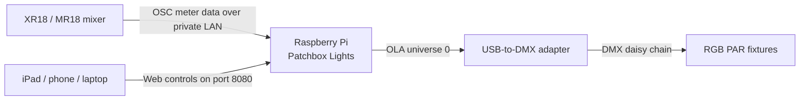

# Patchbox Lights

**A small, hands-off lighting companion for a rehearsal room, band, or venue.**

Patchbox Lights listens to the meters from a Behringer XR18 or Midas MR18 and
uses them to bring four (or more) RGB PAR fixtures to life. A singer's channel
can bring up a white spotlight, while the rest of the rig adds color, movement,
and beat-aware accents. When you want to take over, an iPad-friendly control
panel on the same private network lets you pick the look, adjust brightness,
and black out the rig.

It is designed to run on a Raspberry Pi beside the mixer and DMX adapter. Once
it is set up, the Pi does the listening and lighting on its own; the browser is
just a convenient remote control.

## What it does

- **Spotlight** — assigned mixer meters can raise their corresponding fixtures
  into white. Other fixtures provide colored, audio-responsive background light.
- **Color cycle** — cycle through a palette you choose, together or spread
  across the fixtures, with either an immediate cut or a smooth fade between
  colors. Or choose its **Chase** behavior to send a colored accent forward,
  backward, or bouncing. Both behaviors can run by elapsed time, band peaks,
  or an estimated kick-drum beat.
- **Concurrent fixtures** — choose how many fixtures participate together.
  Chase moves that many fixtures as a group; spread color cycles assign colors
  to groups of that size.
- **Blackout** — a toggle that blanks the fixtures and then returns to the
  selected lighting mode when switched off.
- **Audio controls** — set sensitivity, tune band and
  kick response, choose a kick input, and decide whether meter-driven white
  spotlights may overlay Color cycle effects.
- **Fixture setup** — add fixtures, disable individual fixtures, and assign
  each fixture a spotlight source. Mixer scribble-strip names are shown where
  available, so you can identify channels by name.

Spotlight assignments matter in Spotlight mode. In Color cycle mode they are
used only when the white spotlight overlay is enabled, including when the
Chase behavior is selected. Band inputs are listed on the Fixtures page; their
selection and sensitivity controls live in Audio settings.

**Brightness is mode-specific:** Spotlight mode has separate sliders for white
spotlights and colored Band / ambient lights. Color cycle and Chase share an
effect-brightness slider. The white meter overlay setting is shown with those
effects; it lets an assigned fixture briefly turn white on a meter peak.

## Bill of materials

### Required for the lighting rig

| Item | What it does | Suggested setup |
| --- | --- | --- |
| Raspberry Pi 4B | Runs the lighting engine and the web control panel | Use a reliable USB-C power supply and a microSD card with Raspberry Pi OS. |
| USB-to-DMX512 adapter | Carries DMX from the Pi to the fixtures | This rig uses the FT232RNL-based USB interface cable supplied by the owner. |
| RGB DMX PAR fixtures | Provide the colored light and spot effects | The current rig uses four U’King 36-LED RGB PAR fixtures (two 2-packs). Confirm each fixture is in the matching seven-channel DMX mode. |
| DMX cables | Link the fixtures in a daisy chain | Connect the adapter to fixture 1, then fixture to fixture; a DMX terminator at the final fixture is good practice. |
| Private network / access point | Lets the Pi receive mixer OSC meters and serves the web panel | The Pi and XR18/MR18 need network reachability; a tablet or phone joins the same network to control it. |

### For audio-reactive operation

| Item | What it adds |
| --- | --- |
| Behringer XR18 or Midas MR18 | Supplies live channel, Aux, and Main meter data over OSC. These are the two supported consoles. |
| Ethernet or Wi-Fi connection to the mixer network | Carries the mixer meter stream to the Pi. A wired Ethernet connection is a good option when convenient. |

### Optional

- iPad, phone, or laptop with a web browser for the control panel.
- More compatible seven-channel fixtures. The app can address up to 73 in one
  DMX universe, subject to the power, cabling, and physical capacity of the rig.
- A spare DMX cable and terminator for troubleshooting and stable signal
  distribution.

> **Fixture profile note:** the app's current fixture layout uses seven DMX
> channels per fixture: master dimmer, red, green, blue, strobe, control mode,
> and effect speed. Check the fixture menu/manual and select a compatible
> seven-channel DMX personality before relying on the address list below.

## How the pieces connect



The Pi uses Open Lighting Architecture (OLA) to send DMX. OLA owns the USB
adapter; the live app submits lighting frames to OLA universe 0. The web panel
does not need to stay open for the lights to run.

## Fixture addressing

The live app assigns fixtures consecutive seven-channel slots in universe 0:

| Fixture | DMX start address | Channels used |
| --- | ---: | --- |
| 1 | d001 | 1–7 |
| 2 | d008 | 8–14 |
| 3 | d015 | 15–21 |
| 4 | d022 | 22–28 |
| 5 | d029 | 29–35 |

Set each fixture's start address to match its position. For four fixtures, set
them to **d001, d008, d015, and d022**. The next fixture starts seven slots
later. The app computes this layout from the fixture count in Settings.

## Getting started

This project assumes the Pi has Raspberry Pi OS, Python 3, Flask, and OLA
installed, with OLA's USB DMX output configured and patched to **universe 0**.
The live application is `lights.py`; the standalone DMX scripts are diagnostic
tools and are not needed for normal use.

1. Connect the fixtures in a DMX daisy chain and set their addresses.
2. Connect the DMX adapter to the Pi and make sure OLA sees it on universe 0.
3. Put the Pi and XR18/MR18 on the same reachable private network.
4. Start the app with `python3 lights.py` (or start the configured
   `lights.service` on the Pi).
5. Open `http://<pi-address>:8080/` on a phone, tablet, or computer on that
   network.
6. In **Settings → Audio**, enter the mixer's IP address and choose **Test
   connection**. A successful test turns green. Save the address.
7. In **Settings → Fixtures**, set the number of fixtures and map the spotlight
   source for each one. In **Settings → Audio**, choose band inputs and tune
   sensitivity or kick sync if you want those features.

The default mixer address is `192.168.0.18`; use the address configured on your
own console. The app currently supports Behringer XR18 and Midas MR18 OSC meter
streams. The control panel listens on port **8080**.

## Finding the mixer and channel names

Use **Test connection** to check that the entered mixer IP replies to OSC.
When a fresh set of mixer input names is read, the app looks for a channel
scribble strip named “Kick” (or a clear kick variant) and selects it for beat
sync automatically. You can change that selection at any time; refreshing the
names scans for the suggested Kick again. The connection test only confirms
that the mixer replied to OSC. Live meter status is shown on the main page. The
Kick sensitivity slider controls beat detection independently from the general
and band sensitivity sliders.

## If something is not working

- **The web page does not open:** confirm the Pi is powered, connected to the
  same network, and running the app. Try the Pi's current IP with `:8080`.
- **The connection test fails or meter status says “No meter data”:** verify
  the mixer IP, confirm the mixer is on and reachable, and check that the Pi
  and mixer can communicate on the private network.
- **The panel works but fixtures stay dark:** confirm OLA is running, its USB
  DMX output is patched to universe 0, the fixture addresses match, and the
  fixtures are in DMX mode with the seven-channel personality.
- **The adapter's device name changes:** the live app sends through OLA rather
  than opening `/dev/ttyUSB0` or `/dev/ttyUSB1` directly. Check that OLA still
  recognizes and owns the adapter.
- **A fixture responds at the wrong address:** check the fixture's displayed
  DMX start address against the table above; the app does not configure fixture
  addresses over DMX.

On the Pi, useful service commands are:

```sh
sudo systemctl status lights.service
sudo journalctl -u lights.service -f
```

## Project files

| File | Purpose |
| --- | --- |
| `lights.py` | Live web panel, OSC meter receiver, lighting engine, and OLA DMX output. |
| `dmx_basic.py` | Simple serial-based fixture check for adapters not being managed by OLA. |
| `dmx_color_test.py` | Continuous color-cycle diagnostic using direct serial output. |
| `dmx_ola_color_test.py` | OLA-based DMX color/fade diagnostic for universe 0. |
| `dmx_restart_test.py` | Diagnostic for adapter behavior across process restarts. |
| `tempo_fog.py` | Separate tempo/fog experiment; not part of the live web app. |
| `TECHNICAL.md` | Detailed implementation, protocol, DMX map, and operations reference. |

See [TECHNICAL.md](TECHNICAL.md) for the engineering details.
